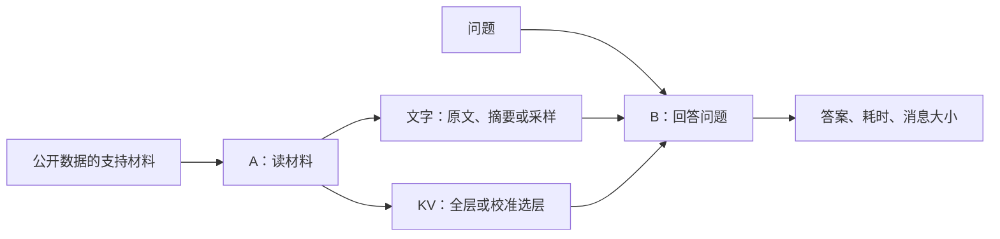

# 我们现在在做什么

最终目标是：**多智能体交流时，找出KV里重复、接收方已经拥有或对当前问题没用的部分，少传这些内容，同时尽量保留协作效果。**

主线分三步：先确认单跳KV通信有实际价值；再在固定多智能体拓扑中测量信息如何重复；最后设计针对接收方的选择或去重方法。第一步的100题探索对照已完成，结果见[本轮报告](D:/liuxin_workspace/ICML2027/experiments/kvcomm_text_kv_baseline_20261001/runs/main7b_20261001_045806/report.md)。

全量KV的F1为75.8，全文文本70.9；差异尚不确定。两者计算耗时接近，但消息约8.13 MB对422 B。当前只确认单跳可运行，尚未证明多智能体KV优于文本，也未开展新冗余算法实验。

同输入核对也已完成：10题中，关闭惩罚或对齐1.05惩罚范围后，全文token拼接与完整KV输出各10/10一致；实际缓存位置正确，中间预测值仍有数值差异。原版聊天格式会改变答案。见[诊断报告](D:/liuxin_workspace/ICML2027/experiments/kvcomm_text_kv_baseline_20261001/runs/alignment7b_20261001_054917/report.md)。

接下来做不同角色/材料输入的三节点链条，先稳定传递，再测重复发送。见[next_steps.md](D:/liuxin_workspace/ICML2027/experiments/kvcomm_text_kv_baseline_20261001/next_steps.md)。本目录已建立独立Git仓库，代码、固定数据与汇总进入版本记录；原始items/vectors/调用账目在本地和云端保留。每30分钟自动化从task_plan.md接续。

先回答：**同一批公开问答，KV比文字更准吗？若差不多，是否少花计算时间？消息又大了多少？**

这轮只有两个节点。A是资料提供者，B是回答者，角色体现在收到的内容和任务上。不是此前五位专家轮流讨论，也没有第三个模型汇总。

文字和KV分别运行，不同时喂给B。原版NLD还让B先答一次，再根据A的文字修订，三次生成全部计成本。

KVComm这里传的是A读材料形成的prefill KV，没有先生成一段推理。多角色多轮推理cache是后续要验证的场景，本轮不直接证明它的冗余。HotpotQA是简答问答；此前五角色MMLU选择题属于旧图实验。旧实验出现的重复生成、上下文不断增长，先按协议/工程问题看，不能直接当成冗余优化收益。

| 文件 | 做什么 |
| --- | --- |
| bootstrap.py | 独立复制源码、冻结题目，用官方函数取支持材料 |
| cpu_check.py | 用随机小模型检查KV选层和生成接口 |
| run.py | 调官方推理函数，补两种文字基线，记录计算 |
| download_model.py | 下载固定7B版本，核验官方权重hash |
| launch.py | 选GPU、后台运行、保持本项目运行锁 |
| pipeline.py | 只有检查和下载通过才跑7B，失败留日志停止 |
| analyze.py | 核对漏题与次数，再汇总比较 |
| config.json | 本轮参数 |
| assets.json、data/ | 固定源码hash和题目名单 |

每次run中，items保存逐题结果，calls.jsonl保存生成/prefill账目，manifest保存版本。COMPLETE和汇总覆盖核对均通过才称完整运行。

具体条件和次数见[运行条件.md](D:/liuxin_workspace/ICML2027/experiments/kvcomm_text_kv_baseline_20261001/运行条件.md)。服务器工程在/home/liuxin/ICML2027/experiments/kvcomm_text_kv_baseline_20261001，使用已有kv-graph独立conda，旧工程不动。
