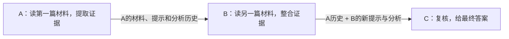

# 我们现在在做什么

目标是研究：多个agent传KV时，接收方重复收到的信息能不能少传。

先确认通信能用，而且与合理的文本方法比较公平，再研究去重。现在用学校服务器上的同一份Qwen7B，角色和输入不同。

文本方式让模型重新读取完整token历史；KV方式复用同一历史的缓存。三个节点都生成，材料来自HotpotQA公开支持句。暂时没有训练G-Design图，也没有压缩KV。

## 已经做完

1. **两节点100题**：全KV与全文文本耗时接近，KV分数稍高但还不足以证明优势；选层虽然少传了约46%，掉分明显。
2. **相同输入10题**：把提示和解码范围对齐，全文拼接与全KV的输出匹配，排除了部分不公平比较。
3. **三节点接入3题**：检查6次B/C缓存接入，5次输出完全一致，1次只是末句换措辞；没有循环或触顶。严格门禁失败，所以真正KV自由链还没跑。
4. **补查那处措辞变化**：绕过KVComm，Qwen原生缓存接口也出现同样变化。现在没有证据说明是KVComm协议坏了。
5. **真正自由KV接力**：C读取实际KV-B产生的缓存；B/C同缓存原生对照各3/3匹配，主9节点正常EOS。最终3题与全文链相同，仍不证明KV更准或去重有效。

三节点阶段这三轮GPU检查共44次生成、17次缓存补尾，实际只涉及3道校准题和1道预热题，包含参考、重放与实现控制。调用数不是题目数。500题预留集没用。

## 文件怎么找

| 内容 | 文件/目录 |
| --- | --- |
| 角色、完整历史、缓存补尾和来源账本 | chain_core.py |
| 三节点检查与启动 | three_node_probe.py |
| 原生缓存接收控制 | native_cache_control.py、cache_path_probe.py |
| 100题结果 | runs/main7b_20261001_045806/report.md |
| 三节点结果 | runs/chain3_20261001_122157/report.md |
| 措辞分歧定位 | runs/cachepath_20261001_123341/report.md |
| 真正自由KV链 | runs/freechain_20261001_125456/report.md |

运行调用官方KVComm的CVCommunicator，原仓库核心代码未改。每个run保存代码快照、条件、逐节点输出、位置、EOS、字节数和调用账目。本地与云端都有结果；Git只放代码、固定数据和摘要，大的原始输出也保留。

## 接着做什么

基础链已检查完成，接下来验证接收方确实已经有的信息能否少传。先准备A给B和C同一来源缓存、B再发给C的场景，让C提前有A；少传后需要能恢复相同的接入缓存。文本也要能去重，才能公平比较。

链条里A跨两条边发送两次，但C第一次收到A，所以约31%还不是“C已知的冗余”。相同来源的缓存去重和语义上已经知道的事实也要分开：先确认机制，再设计信息增量实验，之后才考虑G-Design固定图或选择器。定时任务已按这个阶段更新。

现在来源恢复的学校CPU检查也完成了，没有新增模型调用。固定三角的纯内容账理想能省约24%，文本也一样；若为了命中新加A→C，就不比原来的链少传。极小人工缓存计入引用头后反而更大，还没有真实7B压缩收益。

再核对G-Designer发现：原版只传节点自己的输出，我们的KV适配才携带完整祖先历史。因此下一步要研究不同分析里重复表达的事实，对接收方是否还有增量价值，不能把本适配的重复当作原版文本已有问题。定时已改每小时一次。今天所有轮次和查阅入口见《今日工作记录_20261001.md》。
