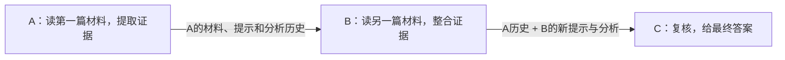

# 我们现在在做什么

目标是研究：多个agent传KV时，接收方重复收到的信息能不能少传。

先确认通信能用，而且与合理的文本方法比较公平，再研究去重。现在用学校服务器上的同一份Qwen7B，角色和输入不同。

文本方式让模型重新读取完整token历史；KV方式复用同一历史的缓存。三个节点都生成，材料来自HotpotQA公开支持句。暂时没有训练G-Design图，也没有压缩KV。

## 已经做完

1. **两节点100题**：全KV与全文文本耗时接近，KV分数稍高但还不足以证明优势；选层虽然少传了约46%，掉分明显。
2. **相同输入10题**：把提示和解码范围对齐，全文拼接与全KV的输出匹配，排除了部分不公平比较。
3. **三节点接入3题**：检查6次B/C缓存接入，5次输出完全一致，1次只是末句换措辞；没有循环或触顶。严格门禁失败，所以真正KV自由链还没跑。
4. **补查那处措辞变化**：绕过KVComm，Qwen原生缓存接口也出现同样变化。现在没有证据说明是KVComm协议坏了。

这次三节点与补查总共24次生成、9次缓存补尾，实际只涉及3道校准题和1道预热题。调用数不是题目数。500题预留集没用。

## 文件怎么找

| 内容 | 文件/目录 |
| --- | --- |
| 角色、完整历史、缓存补尾和来源账本 | chain_core.py |
| 三节点检查与启动 | three_node_probe.py |
| 原生缓存接收控制 | native_cache_control.py、cache_path_probe.py |
| 100题结果 | runs/main7b_20261001_045806/report.md |
| 三节点结果 | runs/chain3_20261001_122157/report.md |
| 措辞分歧定位 | runs/cachepath_20261001_123341/report.md |

运行调用官方KVComm的CVCommunicator，原仓库核心代码未改。每个run保存代码快照、条件、逐节点输出、位置、EOS、字节数和调用账目。本地与云端都有结果；Git只放代码、固定数据和摘要，大的原始输出也保留。

## 接着做什么

检查真正自由生成的A→B→C，确认实际KV-B产生的缓存能稳定传给C；原生缓存接口作为控制，全文重算作为质量对照。不能把两个计算路径每个词都相同，当成协议正确的唯一标准。

链条里A跨两条边发送两次，但C第一次收到A，所以这还不是“C已知的冗余”。链条跑稳后，再接入有共同祖先/多前驱的固定图，测试接收方真正重复收到的历史；这才进入我们的去重问题。
